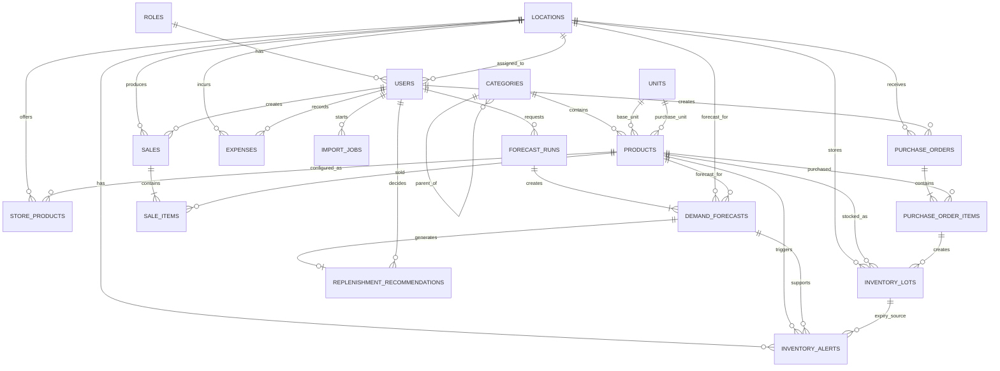

# DATABASE_SPEC_RETAIL_AI_v1.1_MVP_EN

> **Status:** LOCKED FOR MVP  
> **Purpose:** Database source of truth for Backend, Frontend, and ML integration  
> **Database:** PostgreSQL  
> **Scope:** Graduation project — professional but intentionally simplified  
> **Total core tables:** 18  
> **Views:** 2  
> **Related master document:** `PROJECT_MASTER_RETAIL_AI_v1.0.md`

---

# 1. Project Context

## 1.1 Project Name

**Multi-Branch Retail Management System with Demand Forecasting, Revenue Forecasting, and Replenishment Decision Support using Machine Learning**

The system is designed for a mini-mart / convenience-store chain with:

- one central warehouse;
- multiple stores / branches;
- product management;
- inventory management;
- purchase management;
- sales management;
- revenue and expense management;
- chain-level and store-level dashboards;
- Excel/CSV import;
- Machine Learning demand forecasting;
- revenue forecasting;
- replenishment recommendations;
- stockout, overstock, and expiry-risk alerts.

This MVP intentionally **does not attempt to become a full ERP system**.

The database contains only the structures required to support the graduation-project workflows and ML integration while remaining understandable and maintainable.

---

# 2. MVP Database Design Principles

## 2.1 Professional but Simple

The database must:

- use a clear relational design;
- define PK/FK relationships explicitly;
- use constraints to protect data integrity;
- keep basic traceability through `created_by`, timestamps, and transaction statuses where relevant;
- avoid tables that exist only to make the design appear more complex;
- avoid unnecessary duplication of data that can be calculated;
- avoid forcing the full ML dataset schema into the operational application database.

---

## 2.2 Multi-Branch Design

A single `locations` table represents both:

```text
CENTRAL_WAREHOUSE
STORE
```

Example:

```text
WH001 | Central Warehouse
ST001 | MiniMart Area A
ST002 | MiniMart Area B
ST003 | MiniMart Area C
```

---

## 2.3 Product Does Not Store Inventory Quantity

Do not create:

```text
products.quantity
```

Inventory belongs to:

```text
Location × Product × Lot
```

and is managed through:

```text
inventory_lots
```

---

## 2.4 Machine Learning Only Forecasts Demand

The ML model returns:

```text
predicted_quantity
```

The ML model does **not** directly decide the purchase quantity.

The Backend calculates replenishment using:

```text
Recommended Quantity
=
MAX(
    0,
    Predicted Demand
    + Safety Stock
    - Current Stock
    - Incoming Stock
)
```

---

## 2.5 Revenue Does Not Need a Separate Table

Revenue is calculated from completed sales:

```text
sales.total_amount
```

Do not create:

```text
revenues
```

---

## 2.6 Current Inventory Does Not Need a Separate Summary Table

Current inventory is calculated from:

```text
SUM(inventory_lots.quantity_on_hand)
```

and exposed through:

```text
v_inventory_balance
```

This prevents duplicated inventory totals from becoming inconsistent.

---

# 3. Core Table Overview

| # | Table | Purpose |
|---|---|---|
| 1 | `roles` | System roles |
| 2 | `users` | User accounts |
| 3 | `locations` | Central warehouse and stores |
| 4 | `categories` | Multi-level product categories |
| 5 | `units` | Units of measure |
| 6 | `products` | Global product master data |
| 7 | `store_products` | Store-specific product settings |
| 8 | `inventory_lots` | Inventory by lot and expiry date |
| 9 | `purchase_orders` | Purchase documents |
| 10 | `purchase_order_items` | Purchase line items |
| 11 | `sales` | Sales invoices |
| 12 | `sale_items` | Sales invoice line items |
| 13 | `expenses` | Operating expenses |
| 14 | `import_jobs` | Excel/CSV import tracking |
| 15 | `forecast_runs` | ML forecast execution metadata |
| 16 | `demand_forecasts` | Store × Product forecast results |
| 17 | `replenishment_recommendations` | Replenishment recommendations |
| 18 | `inventory_alerts` | Inventory risk alerts |

**Rule:** Do not add another MVP table unless this specification is updated first.

---

# 4. Table Specifications

## 4.1 `roles`

Stores application roles.

| Column | Type | Constraint |
|---|---|---|
| `id` | SMALLSERIAL | PRIMARY KEY |
| `code` | VARCHAR(30) | UNIQUE, NOT NULL |
| `name` | VARCHAR(100) | NOT NULL |

Seed values:

```text
ADMIN
STORE_MANAGER
STAFF
```

Relationship:

```text
roles 1 ─── N users
```

---

## 4.2 `users`

Stores user accounts.

| Column | Type | Constraint |
|---|---|---|
| `id` | UUID | PRIMARY KEY |
| `role_id` | SMALLINT | FK → roles.id, NOT NULL |
| `location_id` | UUID | FK → locations.id, NULL |
| `username` | VARCHAR(100) | UNIQUE, NOT NULL |
| `email` | VARCHAR(255) | UNIQUE, NOT NULL |
| `password_hash` | TEXT | NOT NULL |
| `full_name` | VARCHAR(150) | NOT NULL |
| `is_active` | BOOLEAN | DEFAULT TRUE |
| `created_at` | TIMESTAMPTZ | NOT NULL |
| `updated_at` | TIMESTAMPTZ | NOT NULL |
| `deleted_at` | TIMESTAMPTZ | NULL |

Business rules:

```text
ADMIN:
location_id may be NULL

STORE_MANAGER:
location_id must reference one STORE

STAFF:
location_id must reference one STORE
```

MVP simplification:

```text
One STORE_MANAGER / STAFF user belongs to at most one store.
```

If multi-store user assignment becomes necessary later, a dedicated assignment table may be added in a future version.

---

## 4.3 `locations`

Represents the central warehouse and stores.

| Column | Type | Constraint |
|---|---|---|
| `id` | UUID | PRIMARY KEY |
| `code` | VARCHAR(30) | UNIQUE, NOT NULL |
| `name` | VARCHAR(150) | NOT NULL |
| `location_type` | VARCHAR(30) | NOT NULL |
| `address` | TEXT | NULL |
| `district` | VARCHAR(100) | NULL |
| `city` | VARCHAR(100) | NULL |
| `external_source` | VARCHAR(50) | NULL |
| `external_id` | VARCHAR(100) | NULL |
| `external_city_id` | VARCHAR(100) | NULL |
| `is_active` | BOOLEAN | DEFAULT TRUE |
| `created_at` | TIMESTAMPTZ | NOT NULL |
| `updated_at` | TIMESTAMPTZ | NOT NULL |
| `deleted_at` | TIMESTAMPTZ | NULL |

CHECK:

```text
location_type IN (
    'CENTRAL_WAREHOUSE',
    'STORE'
)
```

FreshRetailNet mapping example:

```text
external_source = 'FRESH_RETAIL'
external_id     = '351'
```

Internal application relationships must continue to use the UUID primary key.

---

## 4.4 `categories`

Supports hierarchical product categories.

| Column | Type | Constraint |
|---|---|---|
| `id` | UUID | PRIMARY KEY |
| `parent_id` | UUID | FK → categories.id, NULL |
| `code` | VARCHAR(50) | UNIQUE, NOT NULL |
| `name` | VARCHAR(150) | NOT NULL |
| `external_source` | VARCHAR(50) | NULL |
| `external_id` | VARCHAR(100) | NULL |
| `is_active` | BOOLEAN | DEFAULT TRUE |
| `created_at` | TIMESTAMPTZ | NOT NULL |

Example:

```text
Food
├── Vegetables
│   ├── Leafy Vegetables
│   └── Root Vegetables
├── Milk
└── Meat

Beverages
├── Soft Drinks
└── Water
```

Relationships:

```text
categories 1 ─── N categories
categories 1 ─── N products
```

---

## 4.5 `units`

Stores units of measure.

| Column | Type | Constraint |
|---|---|---|
| `id` | UUID | PRIMARY KEY |
| `code` | VARCHAR(30) | UNIQUE, NOT NULL |
| `name` | VARCHAR(100) | NOT NULL |
| `symbol` | VARCHAR(20) | NULL |

Examples:

```text
PCS
CAN
BOTTLE
BOX
CARTON
KG
```

---

## 4.6 `products`

Stores global product master data.

| Column | Type | Constraint |
|---|---|---|
| `id` | UUID | PRIMARY KEY |
| `sku` | VARCHAR(50) | UNIQUE, NOT NULL |
| `barcode` | VARCHAR(100) | UNIQUE, NULL |
| `name` | VARCHAR(200) | NOT NULL |
| `category_id` | UUID | FK → categories.id |
| `base_unit_id` | UUID | FK → units.id |
| `purchase_unit_id` | UUID | FK → units.id |
| `purchase_to_base_ratio` | NUMERIC(14,4) | DEFAULT 1 |
| `default_cost` | NUMERIC(14,2) | DEFAULT 0 |
| `track_expiry` | BOOLEAN | DEFAULT FALSE |
| `shelf_life_days` | INTEGER | NULL |
| `external_source` | VARCHAR(50) | NULL |
| `external_id` | VARCHAR(100) | NULL |
| `is_active` | BOOLEAN | DEFAULT TRUE |
| `created_at` | TIMESTAMPTZ | NOT NULL |
| `updated_at` | TIMESTAMPTZ | NOT NULL |
| `deleted_at` | TIMESTAMPTZ | NULL |

CHECK:

```text
purchase_to_base_ratio > 0

default_cost >= 0

shelf_life_days IS NULL
OR shelf_life_days >= 0
```

Example:

```text
Product:
Coca Cola 330ml

base_unit:
CAN

purchase_unit:
CARTON

purchase_to_base_ratio:
24

Meaning:
1 carton = 24 cans
```

MVP supports:

```text
1 base selling unit
+
1 default purchase unit
```

A generalized multi-unit conversion table is intentionally deferred.

---

## 4.7 `store_products`

Stores product configuration for each store.

This is the relationship:

```text
STORE × PRODUCT
```

| Column | Type | Constraint |
|---|---|---|
| `id` | UUID | PRIMARY KEY |
| `location_id` | UUID | FK → locations.id |
| `product_id` | UUID | FK → products.id |
| `selling_price` | NUMERIC(14,2) | NOT NULL |
| `safety_stock` | NUMERIC(14,4) | DEFAULT 0 |
| `min_stock_level` | NUMERIC(14,4) | DEFAULT 0 |
| `is_active` | BOOLEAN | DEFAULT TRUE |
| `updated_at` | TIMESTAMPTZ | NOT NULL |

UNIQUE:

```text
(location_id, product_id)
```

CHECK:

```text
selling_price >= 0
safety_stock >= 0
min_stock_level >= 0
```

Reasons for this table:

- one product may have different prices at different stores;
- safety stock may differ by store;
- a product may be enabled at one store and disabled at another;
- the MVP does not require a separate price-history subsystem.

Historical selling price is preserved in:

```text
sale_items.unit_price
```

---

## 4.8 `inventory_lots`

Stores inventory by lot and expiry date.

| Column | Type | Constraint |
|---|---|---|
| `id` | UUID | PRIMARY KEY |
| `location_id` | UUID | FK → locations.id |
| `product_id` | UUID | FK → products.id |
| `lot_number` | VARCHAR(100) | NULL |
| `quantity_on_hand` | NUMERIC(14,4) | NOT NULL |
| `unit_cost` | NUMERIC(14,2) | NOT NULL |
| `received_date` | DATE | NOT NULL |
| `expiry_date` | DATE | NULL |
| `purchase_order_item_id` | UUID | FK → purchase_order_items.id, NULL |
| `created_at` | TIMESTAMPTZ | NOT NULL |
| `updated_at` | TIMESTAMPTZ | NOT NULL |

CHECK:

```text
quantity_on_hand >= 0
unit_cost >= 0
```

Example:

```text
Store A
Product: Milk P001

LOT-A:
40 boxes
Expiry: 2026-10-10

LOT-B:
60 boxes
Expiry: 2026-10-28
```

Total inventory:

```text
100 boxes
```

The system can still identify the 40 boxes that expire earlier.

---

## 4.9 `purchase_orders`

Stores purchase documents.

Supplier management is intentionally excluded from MVP.

| Column | Type | Constraint |
|---|---|---|
| `id` | UUID | PRIMARY KEY |
| `order_number` | VARCHAR(50) | UNIQUE, NOT NULL |
| `location_id` | UUID | FK → locations.id |
| `status` | VARCHAR(20) | NOT NULL |
| `ordered_at` | TIMESTAMPTZ | NOT NULL |
| `received_at` | TIMESTAMPTZ | NULL |
| `total_cost` | NUMERIC(14,2) | DEFAULT 0 |
| `note` | TEXT | NULL |
| `created_by` | UUID | FK → users.id |
| `created_at` | TIMESTAMPTZ | NOT NULL |
| `updated_at` | TIMESTAMPTZ | NOT NULL |

Status values:

```text
DRAFT
RECEIVED
CANCELLED
```

MVP workflow:

```text
DRAFT → RECEIVED
```

or:

```text
DRAFT → CANCELLED
```

When the order becomes `RECEIVED`, the Backend must update inventory in the same transactional workflow.

---

## 4.10 `purchase_order_items`

Stores purchase line items.

| Column | Type | Constraint |
|---|---|---|
| `id` | UUID | PRIMARY KEY |
| `purchase_order_id` | UUID | FK → purchase_orders.id |
| `product_id` | UUID | FK → products.id |
| `purchase_quantity` | NUMERIC(14,4) | NOT NULL |
| `base_quantity` | NUMERIC(14,4) | NOT NULL |
| `unit_cost` | NUMERIC(14,2) | NOT NULL |
| `lot_number` | VARCHAR(100) | NULL |
| `expiry_date` | DATE | NULL |
| `line_total` | NUMERIC(14,2) | NOT NULL |

CHECK:

```text
purchase_quantity > 0
base_quantity > 0
unit_cost >= 0
line_total >= 0
```

Example:

```text
10 cartons of Coca Cola

purchase_to_base_ratio = 24

base_quantity = 240 cans
```

---

## 4.11 `sales`

Stores sales invoice headers.

| Column | Type | Constraint |
|---|---|---|
| `id` | UUID | PRIMARY KEY |
| `invoice_number` | VARCHAR(50) | UNIQUE, NOT NULL |
| `location_id` | UUID | FK → locations.id |
| `sold_at` | TIMESTAMPTZ | NOT NULL |
| `subtotal` | NUMERIC(14,2) | NOT NULL |
| `discount_amount` | NUMERIC(14,2) | DEFAULT 0 |
| `total_amount` | NUMERIC(14,2) | NOT NULL |
| `status` | VARCHAR(20) | NOT NULL |
| `created_by` | UUID | FK → users.id |
| `created_at` | TIMESTAMPTZ | NOT NULL |

Status:

```text
COMPLETED
VOIDED
```

A sale must not be physically deleted in normal business operations.

Incorrect/cancelled sales should use:

```text
status = VOIDED
```

---

## 4.12 `sale_items`

Stores individual products sold in each invoice.

| Column | Type | Constraint |
|---|---|---|
| `id` | UUID | PRIMARY KEY |
| `sale_id` | UUID | FK → sales.id |
| `product_id` | UUID | FK → products.id |
| `quantity` | NUMERIC(14,4) | NOT NULL |
| `unit_price` | NUMERIC(14,2) | NOT NULL |
| `discount_amount` | NUMERIC(14,2) | DEFAULT 0 |
| `line_total` | NUMERIC(14,2) | NOT NULL |
| `cost_of_goods_sold` | NUMERIC(14,2) | NOT NULL |
| `promotion_flag` | BOOLEAN | DEFAULT FALSE |

CHECK:

```text
quantity > 0
unit_price >= 0
discount_amount >= 0
line_total >= 0
cost_of_goods_sold >= 0
```

Important rule:

```text
unit_price
```

is the selling-price snapshot at transaction time.

Historical invoices must never be recalculated using the product's current price.

---

## 4.13 `expenses`

Stores simple operating expenses.

A separate `expense_categories` table is intentionally not used in MVP.

| Column | Type | Constraint |
|---|---|---|
| `id` | UUID | PRIMARY KEY |
| `location_id` | UUID | FK → locations.id, NULL |
| `expense_type` | VARCHAR(30) | NOT NULL |
| `amount` | NUMERIC(14,2) | NOT NULL |
| `expense_date` | DATE | NOT NULL |
| `description` | TEXT | NULL |
| `created_by` | UUID | FK → users.id |
| `created_at` | TIMESTAMPTZ | NOT NULL |
| `updated_at` | TIMESTAMPTZ | NOT NULL |

Supported expense types:

```text
RENT
SALARY
ELECTRICITY
WATER
TRANSPORT
MARKETING
OTHER
```

Meaning:

```text
location_id IS NULL
```

represents a business-level expense not assigned to one store.

CHECK:

```text
amount >= 0
```

---

## 4.14 `import_jobs`

Tracks Excel/CSV imports.

The MVP does not create one database row for every imported source row.

| Column | Type | Constraint |
|---|---|---|
| `id` | UUID | PRIMARY KEY |
| `import_type` | VARCHAR(30) | NOT NULL |
| `file_name` | VARCHAR(255) | NOT NULL |
| `file_hash` | CHAR(64) | NOT NULL |
| `status` | VARCHAR(20) | NOT NULL |
| `total_rows` | INTEGER | DEFAULT 0 |
| `success_rows` | INTEGER | DEFAULT 0 |
| `failed_rows` | INTEGER | DEFAULT 0 |
| `error_report` | JSONB | NULL |
| `created_by` | UUID | FK → users.id |
| `created_at` | TIMESTAMPTZ | NOT NULL |
| `completed_at` | TIMESTAMPTZ | NULL |

UNIQUE:

```text
(import_type, file_hash)
```

Supported import types:

```text
PRODUCT
INVENTORY
SALE
PURCHASE
EXPENSE
```

Status values:

```text
PENDING
PROCESSING
COMPLETED
PARTIAL
FAILED
```

Example `error_report`:

```json
[
  {
    "row": 52,
    "error": "Product SKU not found"
  },
  {
    "row": 73,
    "error": "Quantity must be positive"
  }
]
```

No `import_job_rows` table is required in MVP.

---

## 4.15 `forecast_runs`

Represents one demand-forecast execution.

The table also stores the model version so the MVP does not require a separate `ml_models` table.

| Column | Type | Constraint |
|---|---|---|
| `id` | UUID | PRIMARY KEY |
| `model_version` | VARCHAR(100) | NOT NULL |
| `algorithm` | VARCHAR(100) | NOT NULL |
| `horizon_months` | SMALLINT | NOT NULL |
| `metrics` | JSONB | NULL |
| `status` | VARCHAR(20) | NOT NULL |
| `requested_by` | UUID | FK → users.id |
| `started_at` | TIMESTAMPTZ | NOT NULL |
| `completed_at` | TIMESTAMPTZ | NULL |

CHECK:

```text
horizon_months IN (1, 3)
```

Status values:

```text
PENDING
RUNNING
COMPLETED
FAILED
```

Example:

```text
model_version = demand-lightgbm-v1
algorithm     = LightGBM
```

Example metrics:

```json
{
  "MAE": 14.2,
  "RMSE": 21.1,
  "WAPE": 0.18
}
```

Actual values must come from real experiments.

---

## 4.16 `demand_forecasts`

Stores ML forecast results.

Grain:

```text
Forecast Run
×
Location
×
Product
×
Forecast Period
```

| Column | Type | Constraint |
|---|---|---|
| `id` | UUID | PRIMARY KEY |
| `forecast_run_id` | UUID | FK → forecast_runs.id |
| `location_id` | UUID | FK → locations.id |
| `product_id` | UUID | FK → products.id |
| `period_start` | DATE | NOT NULL |
| `period_end` | DATE | NOT NULL |
| `predicted_quantity` | NUMERIC(14,4) | NOT NULL |
| `estimated_unit_price` | NUMERIC(14,2) | NOT NULL |
| `predicted_revenue` | NUMERIC(14,2) | NOT NULL |
| `actual_quantity` | NUMERIC(14,4) | NULL |
| `actual_revenue` | NUMERIC(14,2) | NULL |
| `forecast_error` | NUMERIC(14,4) | NULL |
| `created_at` | TIMESTAMPTZ | NOT NULL |

CHECK:

```text
period_end >= period_start
predicted_quantity >= 0
estimated_unit_price >= 0
predicted_revenue >= 0
```

Revenue forecast:

```text
predicted_revenue
=
predicted_quantity × estimated_unit_price
```

No separate revenue-prediction ML model is required in MVP.

---

## 4.17 `replenishment_recommendations`

Stores replenishment recommendations derived from demand forecasts.

| Column | Type | Constraint |
|---|---|---|
| `id` | UUID | PRIMARY KEY |
| `demand_forecast_id` | UUID | FK → demand_forecasts.id, UNIQUE |
| `location_id` | UUID | FK → locations.id |
| `product_id` | UUID | FK → products.id |
| `current_stock_snapshot` | NUMERIC(14,4) | NOT NULL |
| `incoming_stock_snapshot` | NUMERIC(14,4) | DEFAULT 0 |
| `safety_stock_snapshot` | NUMERIC(14,4) | DEFAULT 0 |
| `recommended_quantity` | NUMERIC(14,4) | NOT NULL |
| `manager_quantity` | NUMERIC(14,4) | NULL |
| `decision_status` | VARCHAR(20) | NOT NULL |
| `decided_by` | UUID | FK → users.id, NULL |
| `decided_at` | TIMESTAMPTZ | NULL |
| `decision_note` | TEXT | NULL |

Decision status:

```text
PENDING
ACCEPTED
ADJUSTED
REJECTED
```

Formula:

```text
recommended_quantity
=
MAX(
    0,
    predicted_quantity
    + safety_stock_snapshot
    - current_stock_snapshot
    - incoming_stock_snapshot
)
```

Example:

```text
Predicted Demand = 1000
Safety Stock     = 100
Current Stock    = 300
Incoming Stock   = 50

Recommended Quantity
= 1000 + 100 - 300 - 50
= 750
```

If the manager adjusts the recommendation:

```text
AI Recommendation = 750
Manager Quantity   = 700
Decision Status    = ADJUSTED
```

The adjustment reason is handled by:

```text
decision_note
```

---

## 4.18 `inventory_alerts`

Stores inventory-related alerts.

| Column | Type | Constraint |
|---|---|---|
| `id` | UUID | PRIMARY KEY |
| `location_id` | UUID | FK → locations.id |
| `product_id` | UUID | FK → products.id |
| `demand_forecast_id` | UUID | FK → demand_forecasts.id, NULL |
| `inventory_lot_id` | UUID | FK → inventory_lots.id, NULL |
| `alert_type` | VARCHAR(30) | NOT NULL |
| `severity` | VARCHAR(20) | NOT NULL |
| `message` | TEXT | NOT NULL |
| `status` | VARCHAR(20) | NOT NULL |
| `detected_at` | TIMESTAMPTZ | NOT NULL |
| `resolved_at` | TIMESTAMPTZ | NULL |

Alert types:

```text
STOCKOUT_RISK
OVERSTOCK_RISK
EXPIRY_RISK
```

Severity:

```text
LOW
MEDIUM
HIGH
CRITICAL
```

Status:

```text
OPEN
RESOLVED
```

---

# 5. Database Views

Views are not included in the 18-table count.

## 5.1 `v_inventory_balance`

Purpose:

```text
Calculate current inventory for each Product at each Location.
```

Conceptual SQL:

```sql
SELECT
    location_id,
    product_id,
    SUM(quantity_on_hand) AS current_quantity
FROM inventory_lots
GROUP BY location_id, product_id;
```

Used by:

- Inventory page;
- Dashboard;
- Replenishment calculation;
- Low-stock checks.

---

## 5.2 `v_sales_daily_facts`

Purpose:

- Dashboard analytics;
- data export;
- feature engineering;
- future offline model retraining using sales accumulated by the application.

Grain:

```text
Location × Product × Business Date
```

Conceptual output:

```text
location_id
product_id
business_date
quantity_sold
gross_revenue
discount_amount
promotion_flag
average_unit_price
```

Source:

```text
sales
+
sale_items
```

Only include:

```text
sales.status = 'COMPLETED'
```

FreshRetailNet does not need to be fully inserted into this view.

FreshRetailNet remains the initial external ML training/evaluation dataset.

---

# 6. MVP ERD



---

# 7. Core Relationship Summary

```text
Role
1 ─── N
User
```

```text
Location
1 ─── N
User
```

```text
Category
1 ─── N
Product
```

```text
Location
1 ─── N
StoreProduct
N ─── 1
Product
```

```text
Location
1 ─── N
InventoryLot
N ─── 1
Product
```

```text
Location
1 ─── N
PurchaseOrder
1 ─── N
PurchaseOrderItem
N ─── 1
Product
```

```text
Location
1 ─── N
Sale
1 ─── N
SaleItem
N ─── 1
Product
```

```text
ForecastRun
1 ─── N
DemandForecast
```

```text
Location
1 ─── N
DemandForecast
N ─── 1
Product
```

```text
DemandForecast
1 ─── 0..1
ReplenishmentRecommendation
```

---

# 8. Required Indexes

Do not create indexes on every column.

Use indexes where they support important application queries.

## `users`

```text
(username)
(email)
(location_id)
```

## `products`

```text
(sku)
(barcode)
(category_id)
```

## `store_products`

```text
(location_id, product_id)
```

## `inventory_lots`

```text
(location_id, product_id)
(expiry_date)
```

## `purchase_orders`

```text
(location_id, ordered_at)
(status)
```

## `sales`

```text
(location_id, sold_at)
(status)
```

## `sale_items`

```text
(sale_id)
(product_id)
```

## `expenses`

```text
(location_id, expense_date)
```

## `demand_forecasts`

```text
(location_id, product_id, period_start)
(forecast_run_id)
```

## `inventory_alerts`

```text
(location_id, status, alert_type)
```

---

# 9. Required Unique Constraints

```text
roles.code

users.username
users.email

locations.code

categories.code

units.code

products.sku
products.barcode

store_products(location_id, product_id)

purchase_orders.order_number

sales.invoice_number

import_jobs(import_type, file_hash)

replenishment_recommendations.demand_forecast_id
```

---

# 10. Delete Policy

## 10.1 Master Data

The following master-data entities must not normally be hard-deleted after they have related business data:

```text
users
locations
categories
products
```

Use:

```text
is_active = false
```

and/or:

```text
deleted_at
```

where defined.

---

## 10.2 Transactions

The following transaction/history records must not normally be hard-deleted:

```text
purchase_orders
sales
expenses
forecast_runs
demand_forecasts
replenishment_recommendations
```

Example:

```text
sales.status = VOIDED
```

instead of deleting a historical sale.

---

# 11. Dashboard Calculation Rules

## Revenue

```text
SUM(sales.total_amount)
WHERE sales.status = 'COMPLETED'
```

## Cost of Goods Sold

```text
SUM(sale_items.cost_of_goods_sold)
for completed sales
```

## Gross Profit

```text
Revenue - COGS
```

## Operating Expenses

```text
SUM(expenses.amount)
```

## Estimated Operating Profit

```text
Revenue
- COGS
- Operating Expenses
```

## Current Inventory

Use:

```text
v_inventory_balance
```

## Top Products

Use:

```text
sales
+
sale_items
GROUP BY product
```

## Store Comparison

Use:

```text
sales
GROUP BY location
```

---

# 12. Excel / CSV Import

MVP import types:

```text
PRODUCT
INVENTORY
SALE
PURCHASE
EXPENSE
```

Recommended flow:

```text
Upload
  ↓
Calculate SHA-256
  ↓
Check duplicate file
  ↓
Validate
  ↓
Preview
  ↓
Confirm
  ↓
Import
  ↓
Update import_jobs
```

MVP intentionally does not require:

```text
staging database schema
import_job_rows table
```

Import errors are summarized in:

```text
import_jobs.error_report
```

---

# 13. FreshRetailNet-50K Strategy

FreshRetailNet-50K is:

```text
AN ML TRAINING / EVALUATION DATASET
```

It is **not**:

```text
THE OPERATIONAL DATABASE SCHEMA
```

Do not force every FreshRetailNet field into the application database.

---

## 13.1 Minimal Store Mapping

FreshRetailNet:

```text
store_id
```

maps to:

```text
locations.external_id
```

with:

```text
locations.external_source = 'FRESH_RETAIL'
```

---

## 13.2 Minimal Product Mapping

FreshRetailNet:

```text
product_id
```

maps to:

```text
products.external_id
```

with:

```text
products.external_source = 'FRESH_RETAIL'
```

---

## 13.3 Category Mapping

FreshRetailNet fields:

```text
first_category_id
second_category_id
third_category_id
```

may be mapped into the `categories` hierarchy when useful for demo seed data or ML integration.

---

## 13.4 Model v1 Fields

Fields expected to be useful for the first model:

```text
store_id
product_id
dt
sale_amount
discount
holiday_flag
activity_flag
precpt
avg_temperature
avg_humidity
avg_wind_level
stock_hour6_22_cnt
```

Feature engineering may add:

```text
day_of_week
month
lag_1
lag_7
lag_14
lag_30
rolling_mean_7
rolling_mean_30
```

Target:

```text
sale_amount
```

Fields intentionally not required in the first model:

```text
hours_sale
hours_stock_status
management_group_id
```

The final ML feature list belongs to:

```text
ML_AND_DATA_SPEC_RETAIL_AI_v1.0.md
```

---

# 14. Simplified Data Strategy

The project uses two main data sources.

## A. Public ML Data

```text
FreshRetailNet-50K
```

Used for:

```text
Training
Validation
Evaluation
Demand Forecasting experiments
```

## B. Application Data

Stored in PostgreSQL:

```text
Products
Inventory
Purchases
Sales
Expenses
Forecasts
Recommendations
Alerts
```

Used for:

- running the web application;
- dashboard demonstrations;
- business workflows;
- accumulating new application data;
- possible offline retraining later.

The project does **not** require a single dataset containing all operational and ML fields.

---

# 15. Backend Transaction Rules

## 15.1 Completing a Sale

The Backend must use one atomic database transaction:

```text
1. Validate Store.
2. Validate Products.
3. Validate available inventory.
4. Create Sale.
5. Create SaleItems.
6. Deduct InventoryLots.
7. Commit.
```

If any critical step fails:

```text
ROLLBACK the entire transaction.
```

The application must not leave a sale recorded without the corresponding inventory change.

---

## 15.2 Receiving a Purchase

The Backend must use one atomic database transaction:

```text
1. Validate PurchaseOrder.
2. Update status to RECEIVED.
3. Create/update InventoryLots.
4. Set received_at.
5. Commit.
```

Failure:

```text
ROLLBACK.
```

---

# 16. Inventory Consumption Rule

For products where:

```text
track_expiry = true
```

use:

```text
FEFO
First Expired, First Out
```

For products without expiry tracking:

```text
FIFO
```

or the oldest available lot first.

This rule is implemented in Backend business logic.

---

# 17. Alert Rules

## 17.1 Stockout Risk

Example condition:

```text
Predicted Demand
>
Current Stock + Incoming Stock
```

Result:

```text
STOCKOUT_RISK
```

---

## 17.2 Overstock Risk

Example condition:

```text
Current Stock
>
Predicted Demand + configured threshold
```

Result:

```text
OVERSTOCK_RISK
```

The exact threshold belongs to Backend configuration.

---

## 17.3 Expiry Risk

Example condition:

```text
expiry_date is approaching
AND
quantity_on_hand > 0
```

Result:

```text
EXPIRY_RISK
```

The exact warning window belongs to Backend configuration.

---

# 18. Authorization Rules Related to Database Access

## ADMIN

Can access the full chain.

---

## STORE_MANAGER

Backend queries for store-scoped business resources must enforce:

```text
resource.location_id
=
current_user.location_id
```

Applicable areas include:

```text
inventory
sales
purchases
expenses
forecasts
recommendations
alerts
```

---

## STAFF

MVP permissions include:

- create sales;
- view products;
- view basic inventory availability for the assigned store.

Staff must not access:

```text
profit
expenses
forecast management
replenishment decisions
```

Authorization is enforced in the Backend.

Hiding a Frontend menu is not sufficient security.

---

# 19. Locked Rules for AI Coding

AI coding assistants must not silently change the following decisions:

```text
1. The project is a multi-branch retail system.

2. locations represents both warehouse and stores.

3. An MVP Store Manager / Staff user belongs to at most one store.

4. products does not contain inventory quantity.

5. Inventory belongs to Location × Product × Lot.

6. No separate Revenue table is created.

7. Revenue is derived from completed Sales.

8. One Sale contains multiple SaleItems.

9. One PurchaseOrder contains multiple PurchaseOrderItems.

10. Completing a Sale must reduce inventory in the same database transaction.

11. Receiving a Purchase must increase inventory.

12. Current store selling price belongs to store_products.

13. Historical transaction price is snapshot in sale_items.unit_price.

14. ML predicts demand only.

15. Forecast grain is Location × Product × Time Period.

16. Revenue Forecast = Predicted Demand × Estimated Price.

17. Replenishment is calculated using Backend business rules.

18. Managers may Accept / Adjust / Reject recommendations.

19. Transaction records are not hard-deleted during normal operations.

20. Store Managers may access only their assigned store's operational data.

21. FreshRetailNet is an ML dataset, not the application DB schema.

22. Do not add an MVP table without updating this specification first.
```

---

# 20. Deferred Features — Not MVP

The following are explicitly outside MVP:

```text
Supplier Management

Store-to-Store Transfer

Central Warehouse Allocation Optimization

Customer Management

Customer Loyalty

Customer Recommendation

Detailed Promotion Management

Price History Management

Complex Audit Log

Data Warehouse

Staging Database

Feature Store

Kafka

Microservices

Kubernetes

Automatic Model Retraining

Explainable AI

What-if Simulation
```

These may be reconsidered only after the MVP is stable.

---

# 21. Why This MVP Is Still Professional

Although the design is intentionally simplified, it still includes:

```text
Authentication
RBAC
Multi-store support
Normalized relational database
Product management
Inventory by lot
Expiry tracking
Purchase workflow
Sales workflow
Expense management
Dashboard support
Excel/CSV import
Machine Learning integration
Model-run tracking
Demand forecasting
Revenue forecasting
Replenishment recommendation
Inventory alerts
Database constraints
Transactions
Indexes
Soft-delete strategy
```

The goal is not to maximize the number of tables.

The goal is to produce a coherent system whose UI, Backend, database, and ML components follow consistent business rules.

---

# 22. Final Table List

```text
01 roles
02 users
03 locations
04 categories
05 units
06 products
07 store_products
08 inventory_lots
09 purchase_orders
10 purchase_order_items
11 sales
12 sale_items
13 expenses
14 import_jobs
15 forecast_runs
16 demand_forecasts
17 replenishment_recommendations
18 inventory_alerts
```

Views:

```text
01 v_inventory_balance
02 v_sales_daily_facts
```

---

# 23. MVP Data Flow

```text
                    ADMIN / STORE MANAGER
                              │
                              ▼
                         WEB APPLICATION
                              │
                              ▼
                          POSTGRESQL
                              │
               ┌──────────────┼──────────────┐
               ▼              ▼              ▼
             SALES         INVENTORY      EXPENSES
               │              │
               └──────┬───────┘
                      ▼
                 DASHBOARD
                      │
                      ▼
              MACHINE LEARNING
                      │
                      ▼
              DEMAND FORECAST
                      │
              ┌───────┴────────┐
              ▼                ▼
        REVENUE FORECAST    INVENTORY
                            DECISION
                               │
                     ┌─────────┴─────────┐
                     ▼                   ▼
                REPLENISHMENT         ALERT
```

---

# 24. Git / Version-Control Placement

Git workflow rules are **not owned by this Database Specification**.

This document may be version-controlled in Git, but branch strategy, commit rules, rollback policy, and stable checkpoints belong to:

```text
PROJECT_MASTER_RETAIL_AI_v1.0.md
```

and the current Git state belongs to:

```text
PROJECT_STATE.md
```

Examples of state tracked in `PROJECT_STATE.md`:

```text
Current Branch
Last Stable Commit
Last Stable Tag
Uncommitted Work
Next Task
```

Database-specific Git rule:

```text
If a database schema change is required,
update this specification first,
then update Prisma schema/migration,
then test,
then commit the change.
```

Do not store general Git workflow instructions inside the database table definitions.

---

# 25. Document Status

```text
Version:
v1.1_MVP_EN

Status:
DATABASE DESIGN LOCKED FOR MVP
```

Changes compared with the earlier v1.0 design:

```text
- Reduced the design to 18 core tables.
- Removed Supplier.
- Removed user-location assignment table.
- Removed generalized product-unit mapping table.
- Removed price-history table.
- Removed detailed promotion tables.
- Removed inventory movement ledger.
- Removed stock-transfer tables.
- Removed expense-category table.
- Removed import-row table.
- Removed physical analytics fact table.
- Removed standalone ml_models table.
- Removed complex audit_logs table.
- Added simple FreshRetailNet external IDs directly to master data.
- Preserved all required graduation-project functionality.
```

This document is the **single source of truth for the MVP database design**.

Any future change to tables, columns, PK/FK relationships, constraints, or core database business rules must update this file before implementation.
