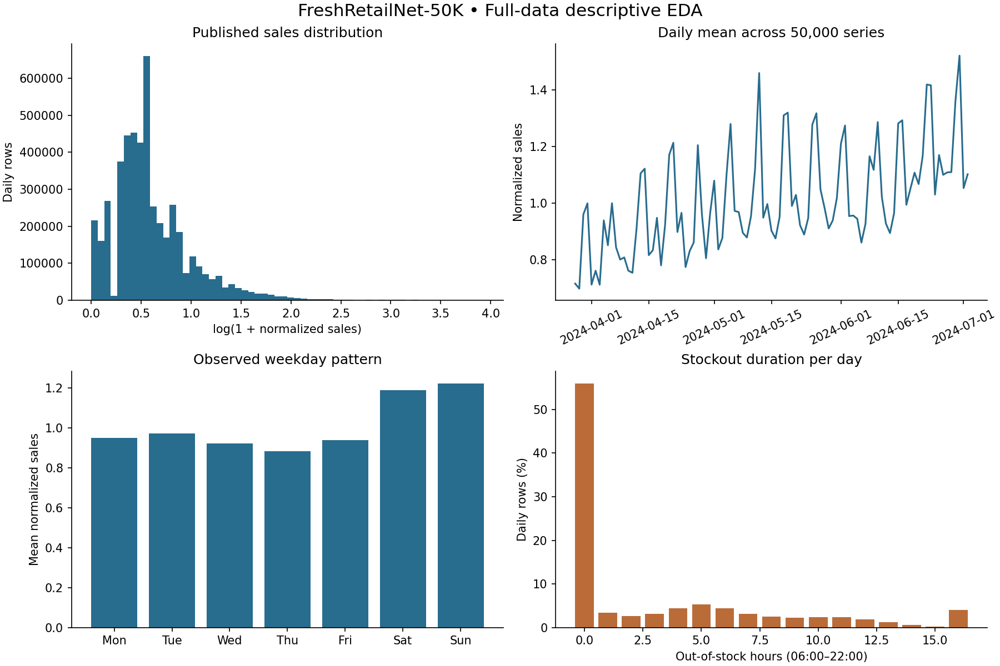

# FreshRetailNet-50K: preparation and exploratory analysis

Date: 2026-09-26. Scope: Phase 5, Gate 1. **No model has been trained, evaluated or selected.** Recommendations below await review.

Review outcome: Gate 2 was subsequently approved with the temporal split, Seasonal Naive versus LightGBM and normalized-source training/evaluation only. The owner did not approve the proposed relative-demand transformation or physical-unit conversion. The historical findings below remain unchanged; the training report will record the subsequent experiment.

## 1. Dataset and reproducibility

Publisher: Dingdong-Inc. Dataset: [FreshRetailNet-50K](https://huggingface.co/datasets/Dingdong-Inc/FreshRetailNet-50K), revision `08c1fab7f9257bc73679d415d65d644165d351d4`, licensed [CC BY 4.0](https://creativecommons.org/licenses/by/4.0/). Methodology: Wang et al., [FreshRetailNet-50K: A Stockout-Annotated Censored Demand Dataset for Latent Demand Recovery and Forecasting in Fresh Retail](https://arxiv.org/abs/2505.16319), 2025. Attribution belongs to the dataset authors; the preparation described here is separate work.

Local raw path, relative to the repository: `ml-service/data/raw/freshretailnet-50k/`. Files were downloaded from the publisher at the pinned revision and verified against its published SHA-256 hashes. No sampling or operational database import was used. Raw files remain unchanged. File sizes, hashes and source URLs are recorded in `../dataset_manifest.json` and [eda_summary.json](eda_summary.json).

| Source file | Rows | Period, inclusive | Days per pair | File bytes |
| --- | ---: | --- | ---: | ---: |
| train.parquet | 4,500,000 | 2024-03-28–2024-06-25 | 90 | 106,436,287 |
| eval.parquet | 350,000 | 2024-06-26–2024-07-02 | 7 | 8,440,124 |
| Combined | **4,850,000** | **2024-03-28–2024-07-02** | **97** | **114,876,411** |

Measured coverage: **898 stores, 865 products, 18 cities and 50,000 Store × Product pairs** in both files. Every pair has all 97 consecutive days. Counts are computed from these files; some versions of the accompanying research text list 863 products.

Run from `ml-service` using Python 3.11:

```powershell
.\.venv\Scripts\python -m pip install -r requirements-eda.txt
.\.venv\Scripts\python -m src.dataset
.\.venv\Scripts\python -m unittest discover -s tests -v
.\.venv\Scripts\python -m src.eda
```

The first command installs the separate offline analysis dependencies. `src.dataset` verifies existing files and only downloads missing files. `src.eda` checks raw integrity again, audits all rows, prepares features, and regenerates the JSON summary and one four-panel figure. This report's interpretation is reviewed prose; rerunning the program does not overwrite it. Large raw/processed files are ignored by Git. Source code, manifest, dependency versions and compact reports are tracked. Runtime does not require `docs/`.

## 2. Target meaning and schema

The business objective remains daily quantity demand. However, the publisher defines `sale_amount` as **globally normalized sales**, multiplied by an unspecified coefficient. Retain these published values; do not infer a conversion from apparent decimal increments. They are not directly identified as RetailSense base units or currency. No revenue model or physical-unit forecast is created in Gate 1. A scale strategy must be agreed before operational quantity/revenue/replenishment integration.

| Fields | Raw types | Role |
| --- | --- | --- |
| city_id, store_id, management_group_id, three category IDs, product_id | int64 | Encoded identifiers |
| dt | string | Parsed strictly as ISO date, then sorted within pair |
| sale_amount | float64 | Published daily target; unchanged |
| hours_sale | list of float64 | 24 values; audit only |
| stock_hour6_22_cnt | int32 | Out-of-stock hours, 0–16 |
| hours_stock_status | list of int64 in Parquet | 24 binary values; audit only |
| discount | float64 | Price multiplier; 1 means no discount |
| holiday_flag, activity_flag | int32 | Binary flags |
| precpt, avg_temperature, avg_humidity, avg_wind_level | float64 | Observed context; audit only |

All **19 columns** were checked. The Parquet schema records hourly stock elements as int64, whereas the dataset card describes an int32 sequence; values have valid binary semantics, so no lossy cast is required.

## 3. Missing, duplicate and abnormal data

- Original data: **zero missing scalar values, null lists or null hourly elements**. Zero invalid dates, negative/non-finite sales, invalid identifiers or invalid binary flags.
- **Zero duplicate daily keys**, therefore zero exact duplicate rows; zero records removed. The reusable cleaner removes exact full-row duplicates, but rejects conflicting daily records without summing them.
- **34 discount values exceed 1**, maximum 1.088. Only those context cells become NA in the cleaned copy; all associated sales remain. No replacement median, forward fill or clipping is fitted. No other numeric context values violate the documented ranges. A zero discount also occurs; its business meaning cannot be inferred as ordinary no-discount pricing.
- Every hourly sequence has 24 values. All daily sales equal their hourly sums within numerical tolerance. Every daily stock count equals the sum of the raw out-of-stock mask at hours **06 through 21**; hour 22 is excluded. No inconsistent rows were found.
- Target range: 0–49.9; median 0.7; mean 1.0126; 95th percentile 3.0; 99th 5.9; 99.9th 21.0. This is a right-skewed distribution. Large observations are retained; high sales alone do not establish an error.
- Missing dates in a future input remain unknown, not automatically zero sales. Missing targets remain NA, and affected full-history training rows become ineligible. Invalid targets/IDs/dates cause a clear failure requiring inspection. Optional invalid context is counted and masked, with original files preserved.

## 4. Zero sales and stockout conditions

| Measure | Result |
| --- | ---: |
| Zero-sales rows | **215,323 / 4,850,000 = 4.4396%** |
| Zero-sales rows with some daytime stockout | 164,587 (76.44% of zero-sales rows) |
| Zero-sales rows with no recorded daytime stockout | 50,736 |
| Days with at least one daytime stockout hour | **2,135,444 = 44.0298%** |
| Days with all 16 daytime hours out of stock | 194,332 (4.0068%) |
| Out-of-stock daytime hours | **15,325,567 / 77,600,000 = 19.7494%** |
| Pairs with zero sales across all 97 days | 0 |

The day-level percentage and hour-level percentage use different denominators. They must not be reported as the same measure. The 7-day eval file contains 61 all-zero series, relevant to undefined per-series WAPE denominators.

**Proposed simple handling:** retain observed sales, including zeros and stockout days. Preserve stockout fields for diagnostic slices. Later report errors separately for stockout/no-stockout targets as well as all targets; do not use the target day's actual stockout indicator as an inference feature. Do not estimate or insert lost demand. Removing every affected day would discard 44% of the data and bias the sample. Forecasts trained this way estimate observed sales and can underestimate unconstrained demand.

## 5. Time patterns and candidate inputs



Observed average normalized sales by weekday: Monday 0.9505, Tuesday 0.9720, Wednesday 0.9217, Thursday 0.8833, Friday 0.9398, Saturday 1.1911, Sunday 1.2235. The mean of the two weekend-day means is about **29.34% above** the mean of the five weekday means. This is descriptive evidence for weekday features and a weekly seasonal baseline, not a causal effect or model result. The time chart also shows a rising level and pronounced weekly peaks; 97 days cannot establish annual seasonality.

| Input | Recommendation and reason |
| --- | --- |
| lag_1, lag_7, lag_14, lag_30 | Prepare; exact calendar-day lookup within pair |
| rolling_mean_7, rolling_mean_14, rolling_mean_30 | Prepare; complete prior windows only, excluding target day |
| day_of_week, month | Prepare; known future calendar information; month may not transfer well across unobserved months |
| store_id, product_id | Retain for grouping and traceability; initially exclude as learned categories so new RetailSense UUIDs do not require arbitrary mapping |
| stock count and hourly stock status | Diagnostics only; future actual stockouts are unknown, and current inventory is not historical availability |
| hours_sale | Exclude; same-day values sum to the target and leak the answer |
| discount, activity_flag | Analyze but exclude initially; RetailSense has no future promotion schedule, and invoice discount amounts are not equivalent to this price multiplier |
| holiday_flag | Exclude initially; source holidays belong to a different market and RetailSense has no equivalent agreed calendar input |
| Weather fields | Exclude initially; observed future weather is unavailable at the forecast origin, and no forecast-weather integration is in scope |
| City/category/management IDs | Retain metadata; exclude initially due to anonymized identities and transfer assumptions |

Full-data Pearson correlations with sales are included in the JSON only as descriptive context: discount −0.333, stockout count −0.102, holiday 0.081, and weather correlations approximately −0.008 to 0.062. These pool heterogeneous series and **do not prove predictive or causal value**. Selection must be checked on the training/validation periods; test targets must not tune features.

## 6. Prepared outputs and leakage controls

Generated, ignored files under `ml-service/data/processed/freshretailnet-50k/`:

- `daily_clean.parquet`: all 4,850,000 daily rows, scalar context, original source split; 17,232,060 bytes.
- `daily_features.parquet`: keys, target, source split, nine candidate input features, eligibility flags and proposed chronological labels; 48,512,734 bytes.

There are **3,350,000 eligible one-step rows**. The first 30 days for each pair (1,500,000 rows) remain in the files as history with `training_eligible = false`. They are not silently removed. No scaling, winsorization, imputation fit, model training or metric computation is performed. Output hashes and software versions are in the JSON.

Lags use matching calendar dates within the same pair. Rolling windows use only days before the target date and require complete windows. Tests change present/future target values and verify that features for earlier dates and the changed date remain identical. Tests also cover missing dates, missing targets, pair isolation and exact boundary behavior.

**The feature table is not a ready-made fixed-origin multi-step evaluation matrix.** Validation/test rows contain legitimate one-step history, including earlier observed values within those periods. For a forecast made once for a future month/week, Gate 2 must rebuild histories recursively from only the forecast origin and its own preceding predictions. Feeding validation/test actuals into later forecast days would leak information and overstate performance.

No global mean/median scaler is fitted across partitions. Any later scaling or category mapping must use training data or history available at each forecast origin only. EDA inspected the full dataset as requested, including eval descriptive statistics; consequently this is a declared holdout, not an unseen external dataset. Avoid test-driven redesign and evaluate the final model only after validation choices are fixed.

## 7. Review proposals: history, split, horizon and models

**Minimum history:** 30 consecutive complete daily observations per Store × Product are necessary for the prepared features; prefer 60 or more for a more stable level/weekly pattern. Thirty days is a mathematical input requirement, not a measured guarantee of forecast quality. Operational absence of transaction rows must not become zero until complete reporting coverage is established. Too little history should later produce `INSUFFICIENT_HISTORY`.

**Chronological proposal:** reserve the publisher's eval period for final testing and use the last 30 days of its training file for validation. No random split.

| Partition | Inclusive dates | Calendar days | Rows | Eligible targets |
| --- | --- | ---: | ---: | ---: |
| Training history | 2024-03-28–2024-05-26 | 60 | 3,000,000 | 1,500,000, starting 2024-04-27 |
| Validation | 2024-05-27–2024-06-25 | 30 | 1,500,000 | 1,500,000 |
| Final test | 2024-06-26–2024-07-02 | 7 | 350,000 | 350,000 |

This departs from the initial approximate 70/15/15 suggestion to preserve a full 30-day validation window and the official eval boundary. Only 30 target days per pair remain for initial fitting after the 30-day warm-up. All 50,000 pairs are available; no subset has been silently substituted.

**Forecast horizon:** first compare a fixed-origin 7-day forecast within validation and on the final 7-day test. Also run a separate fixed-origin 30-day validation forecast from May 26 to assess a one-month estimate. Report horizon-specific MAE, RMSE and aggregate WAPE on the same dates for every candidate, and do not compare 7-day and 30-day metrics as equal tasks. Choose feature/model settings using validation only. A selected configuration may then be refitted through June 25 before the final 7-day test.

One month remains the intended business forecast, with reliability qualified by only one 30-day validation origin and **no independent 30-day final test**. A 90-day/three-month result can only be an explicitly unvalidated planning estimate with this dataset; 97 total days do not support 30 days of history plus 90 days of held-out truth. Do not claim equal accuracy across horizons. Calendar-month boundaries and deployment behavior remain for the integration review.

**Candidates:** one simple weekly seasonal-naive baseline versus one small LightGBM model. A recent-mean baseline is a reasonable alternative if preferred; Random Forest and additional models are unnecessary initially. No model is selected in Gate 1. WAPE must be defined as aggregate absolute error divided by aggregate actual demand; if that denominator is zero, return undefined rather than inventing zero error.

**Scale decision before training/integration:** recommend reviewing a simple relative-demand formulation: scale inputs and target using only recent history at the forecast origin, predict a relative quantity, then restore the scale from that same series' history. This may avoid requiring the unpublished global coefficient when applying the model to physical-unit histories. It is a proposal, not an implemented or validated transfer method; zero-history/zero-scale handling and recursive behavior require explicit agreement and tests. Do not multiply raw FreshRetailNet predictions by a RetailSense price, infer a coefficient, or claim that this EDA establishes transfer accuracy.

## 8. Limitations and gate status

- Source sales are normalized and stockout-censored. Original physical units and lost demand are not recovered.
- Only 97 days, one geographic/business setting, anonymized products and limited seasons are represented. Calendar, demand level and assortment may shift in deployment.
- No model metrics exist yet. Feature usefulness and transfer quality are hypotheses to validate, not demonstrated results.
- FreshRetailNet is isolated from PostgreSQL; no web, inventory, import or financial behavior changed.
- Gate 1 analysis and feature preparation are complete. **Gate 2 requires approval of this report, the scale strategy, split, candidates and horizon limitations.** Gates 2–4 and the Phase 5 milestone remain unfinished.

Verification: 12 Python preparation/audit tests passed, dependency consistency and Python compilation passed, and a second full-data run produced identical processed-file SHA-256 hashes. The existing service health handler remains correct. The preflight backend build and all 184 regression tests passed. No frontend/backend business source or runtime model-service dependencies changed. The overview figure was visually inspected.
